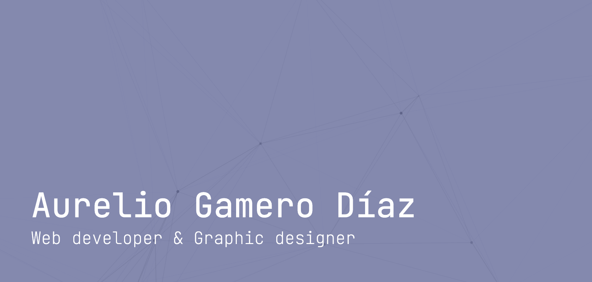

# Aurelio Gamero Díaz — Portfolio

**Personal portfolio and CV of Aurelio Gamero Díaz, Senior Frontend Developer & Graphic Designer.**

🌐 **Live website:** [https://agamdaz.github.io/portfolio/](https://agamdaz.github.io/portfolio/)

## About

This website brings together my professional experience, selected projects, technical articles, and skills across frontend development, UX/UI design, and design systems.

My background combines frontend engineering and visual design, with a particular interest in building user interfaces, developing reusable components, and creating consistent digital experiences.

## Built with

- HTML5
- CSS3
- JavaScript
- [Particles.js](https://vincentgarreau.com/particles.js/) — background particle animation
- [Google Fonts](https://fonts.google.com/) — IBM Plex Sans and JetBrains Mono

## Development

A static website built with vanilla HTML, CSS, and JavaScript. No build tools or frameworks are required.

To run it locally, clone the repository and serve the project directory using a local development server.

## License

No open-source licence has been assigned to this repository. All rights reserved.
